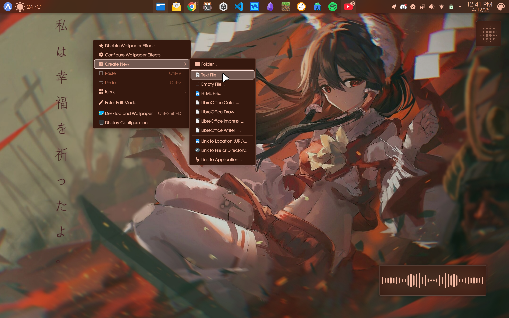

# dotfiles

Personal Linux dotfiles for a KDE-first workflow with optional Hyprland support. The repository contains the terminal, shell, prompt, editor, multiplexer, and file manager configuration used in this setup.



> The screenshots show an earlier rice. The `main` branch contains the current configurations. The `icicle-jellypop` branch keeps the older wallpaper-focused setup.

## Included

| Area | Configuration |
| --- | --- |
| Shell | Zsh, Zinit, completions, aliases, and shell integrations |
| Prompt | Oh My Posh with Rose Pine colors, Git status, system usage, and execution time |
| Terminal | Kitty with Agave Nerd Font Mono and true color support |
| Editor | NvChad settings through `chadrc.lua` |
| Multiplexer | Tmux with TPM and Catppuccin support |
| File manager | Yazi with custom keymaps and theme |
| System info | Fastfetch with a Sakura logo and Rose Pine hardware/software sections |
| Desktop | KDE Plasma as the primary desktop, with optional Hyprland and Rofi files |

## Requirements

Install the tools you want before applying the configuration. The installer only creates links and does not install packages or plugins.

### Core tools

- Zsh
- Git and curl
- Kitty
- Oh My Posh
- Fastfetch
- Tmux
- Yazi
- Neovim
- Fzf, eza, and zoxide
- A Nerd Font. Kitty is configured for `Agave Nerd Font Mono`.

### KDE workflow

- KDE Plasma

### Optional Hyprland workflow

- Hyprland
- hypridle and hyprlock
- Rofi
- swww, yad, ImageMagick, pywal, Gradience, and cava for the wallpaper scripts
- `JetBrainsMono Nerd Font` for the Hyprlock configuration

## Install

Clone the repository and run the installer:

```bash
git clone https://github.com/NONAN23x/dotfiles.git ~/Projects/dotfiles
cd ~/Projects/dotfiles
./install.sh
```

Preview the changes first if you prefer:

```bash
./install.sh --dry-run
```

The installer links tracked files into `${XDG_CONFIG_HOME:-$HOME/.config}` and `~/.zshrc`. Files are linked individually so Tmux plugins and generated Hyprland files stay outside the repository. Existing files are moved to:

```text
${XDG_STATE_HOME:-$HOME/.local/state}/dotfiles-backups/<timestamp>/
```

Run the installer again after pulling updates. Existing links created by this repository are left in place, so the command is safe to repeat.

### Neovim overlay

The repository tracks NvChad's `chadrc.lua`, not the full NvChad starter configuration. Install the starter before running the installer if you want the Neovim settings applied:

```bash
git clone https://github.com/NvChad/starter ~/.config/nvim
./install.sh
```

If NvChad is not present, the installer skips the `chadrc.lua` link and prints a note.

## First run

Zinit is bootstrapped by `.zshrc` the first time a new Zsh session starts. The shell needs Git and network access for this step.

Install the Tmux plugins after linking the Tmux configuration:

```bash
git clone https://github.com/tmux-plugins/tpm ~/.config/tmux/plugins/tpm
git clone -b v2.1.3 https://github.com/catppuccin/tmux.git ~/.config/tmux/plugins/catppuccin/tmux
```

Start Tmux and press `Ctrl-b`, then `Shift-i`, to install the plugins declared in `tmux.conf`.

Start a new Zsh session after installation so the prompt and shell integrations are loaded.

## Hyprland

The installer also links `config/hypr` and `config/rofi`. The Hyprland files are optional and do not replace the KDE configuration.

The wallpaper scripts expect a separate wallpaper directory at `~/.wallpapers/` and a `currentWall` symlink. Wallpapers are intentionally kept outside this repository.

Review the paths and commands in `config/hypr/wall.sh` and `config/hypr/switchwall.sh` before using them. They call external tools for wallpaper changes, color generation, Rofi banners, and Cava updates.

## Updating

```bash
cd ~/Projects/dotfiles
git pull --ff-only
./install.sh
```

## Removing the links

The installer does not delete existing files. To stop using a link, inspect it first and then remove the link itself with `unlink`. Restore any previous file from the backup directory if needed.

## Branches

- `main` contains the current terminal and desktop configuration.
- `icicle-jellypop` contains the older wallpaper-focused setup.
